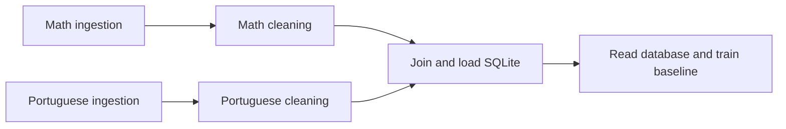
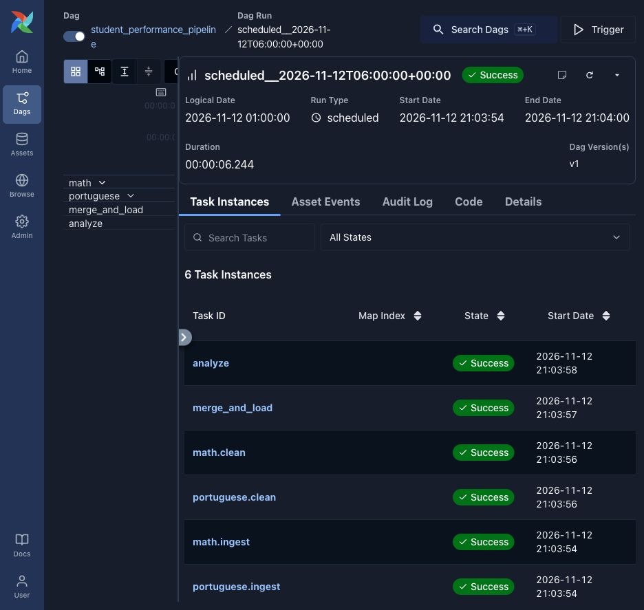
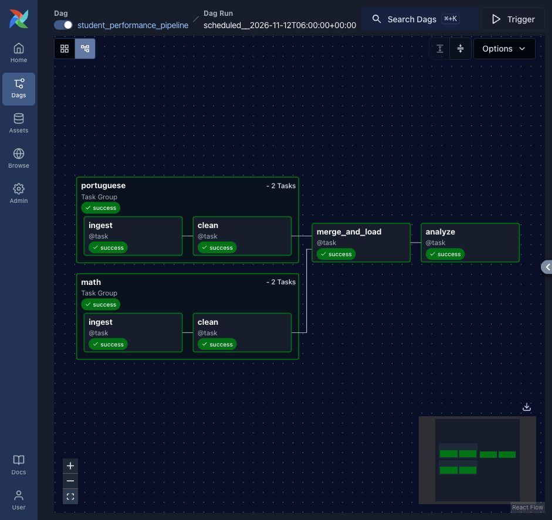
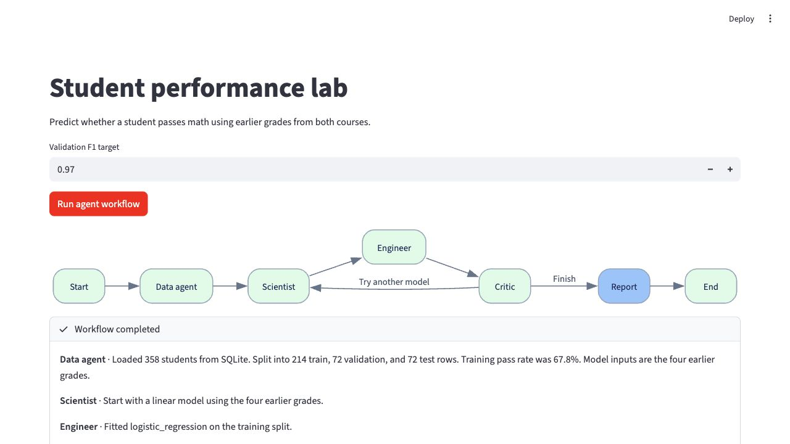
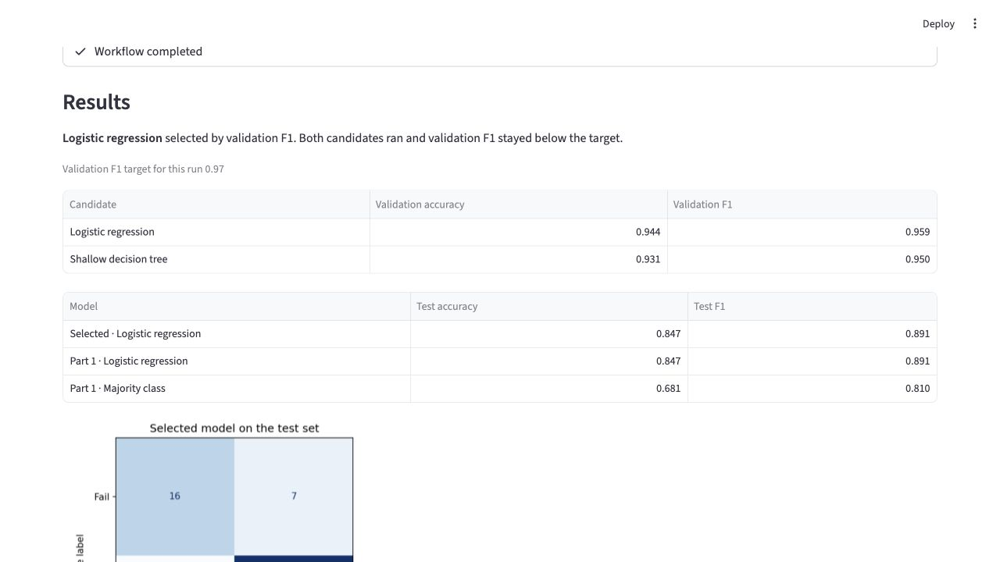

# Student performance: Airflow + an agent ML loop

A small implementation of assignment Parts 1 and 2. Airflow downloads and cleans two student tables, joins them into SQLite, and trains logistic regression. A LangGraph workflow then reads that same database and coordinates model selection. Everything runs in two local Docker containers; no API keys are needed.

## Run

Install and start Docker Desktop. From this folder:

```bash
docker compose up --build -d
```

On native Linux, first run `export AIRFLOW_UID=$(id -u)` so container tasks can write to the mounted project directory.

1. Open [Airflow](http://localhost:8080). Local administrator access is automatic. Wait for `student_performance_pipeline` to appear, then open its latest run. It is enabled on creation; you can also use **Trigger** to run it immediately.
2. Wait for all six tasks to succeed. Expand the Math and Portuguese groups in the Graph tab.
3. Open the [agent app](http://localhost:8501) and click **Run agent workflow**. The graph updates as each agent finishes; results appear below it.

Useful commands:

```bash
docker compose ps
docker compose exec airflow airflow dags trigger student_performance_pipeline
docker compose exec agents python agents.py
docker compose exec airflow python -m pytest -q
docker compose down
```

The first build downloads dependencies. The DAG downloads the small public dataset each run, so it needs internet access. SQLite data stays in `data/`; Airflow history stays in a Docker volume. This is a classroom setup bound to localhost, not a production deployment.

## Data and pipeline

Source: [UCI Student Performance](https://archive.ics.uci.edu/dataset/320/student%2Bperformance), Paulo Cortez (2008), [CC BY 4.0](https://creativecommons.org/licenses/by/4.0/). The archive contains **395 Math** and **649 Portuguese** records from two schools.

Each branch strips whitespace, converts numeric fields, checks required values and valid integer ranges, and removes exact duplicate rows. The tables join using the 13 attributes specified in UCI's `student-merge.R`. These attributes are not guaranteed unique: we exclude every key that is duplicated in either table, then enforce a one-to-one inner join. The result is **358 students**: 243 pass Math and 115 fail. Eleven ambiguous key groups remove 12 Math and 23 Portuguese records; another 25 Math and 268 Portuguese records have no remaining counterpart.



The DAG runs **daily at 06:00 UTC**, with `catchup=False`, one retry, and one active DAG run. The two subject TaskGroups run independently using `LocalExecutor` with four task slots. Loading waits for both branches; analysis waits for loading. A transaction replaces the `students` table in `data/students.db`, so reruns do not append duplicate rows. This historical dataset is static; scheduling demonstrates orchestration rather than new daily observations.

## Agent changes from class

Adapted from the supplied [AutoML Research Lab branch](https://github.com/Kedar-V/automl-research-lab/tree/refactor/lab-solution-layout), specifically its [LangGraph solution](https://github.com/Kedar-V/automl-research-lab/blob/a294145ea9aa4225908ce701c06160c33213335d/solution/langgraph/graph.py).

| Class role | This assignment |
|---|---|
| Data scientist | `data_agent`: read SQLite and make reproducible train/validation/test splits |
| Hypothesis generator | `scientist`: propose logistic regression, then a depth-3 decision tree |
| ML engineer | `engineer`: train the proposed model |
| Judge | `critic`: evaluate validation F1 and decide whether to try again |
| Memory/context nodes | A small shared history records candidate scores |
| Holdout evaluation | `report`: select by validation F1 and evaluate the chosen model on test data |

The live graph is generated from the actual compiled LangGraph and follows streamed node updates. To keep the example simple, agents use deterministic rules, following the class example's fallback approach, rather than LLM calls or separate services. At the default validation-F1 target of **0.97**, at most two candidates are tried. If the target is unmet, the best candidate is still reported honestly. This implements a bounded feedback loop; it does not claim the optional Part 3 benchmark/evaluation suite.

## Evaluation and findings

Target: final Math grade `G3 >= 10`. Inputs: Math and Portuguese **G1/G2 only**, so this is a prediction after the second grading period. Final grades and student identifiers are excluded from model features. A seed-42 stratified split gives **214 training, 72 validation, and 72 test students**. Scaling is fit only on training rows. Validation controls model selection; test scores do not control the loop.

| Workflow / model | Validation F1 | Test accuracy | Test F1 (pass class) |
|---|---:|---:|---:|
| Airflow: logistic regression | 0.959 | 84.7% | 0.891 |
| Agent-selected logistic regression | 0.959 | 84.7% | 0.891 |
| Majority-class baseline | — | 68.1% | 0.810 |

The loop tried the decision tree (validation F1 **0.950**), then retained logistic regression. Neither candidate reached the 0.97 stopping target. The loop demonstrated feedback and selection but did **not** improve the baseline. The selected model correctly classified 61 of 72 test students: 16 failures and 45 passes, with 7 failures predicted as passes and 4 passes predicted as failures.

Results are saved in `outputs/baseline_metrics.json` and `outputs/agent_metrics.json`. The agent history records each attempt. These are illustrative results from a small historical sample; prior grades are strong predictors, and the sample/linkage limits generalization to other schools. Both workflows use the same split for a fair comparison; test metrics never control agent selection.

## Files and evidence

- `dags/student_pipeline.py`: scheduled DAG and parallel TaskGroups.
- `pipeline.py`: ingestion, cleaning, join, and SQLite access.
- `modeling.py`: shared split, models, metrics, and baseline analysis.
- `agents.py` / `app.py`: modified agent loop and live graph/results UI.
- `Dockerfile`, `compose.yaml`, `requirements.txt`: containerized development setup.
- `tests/`: checks for cleaning, ambiguous joins, reruns, split isolation, and agent routing.
- `outputs/`: measured results and data-quality counts.
- `screenshots/`: successful Airflow run, expanded DAG graph, agent graph, and evaluation results.

Raw downloads and local databases are ignored by Git and recreated by the DAG. The source code, measured output files, and screenshots form the submission.

Verified: all **10 tests pass**, dependency checks pass, and the scheduled Airflow run completed all six tasks successfully. Both ingestion tasks and both cleaning tasks overlapped in execution.





